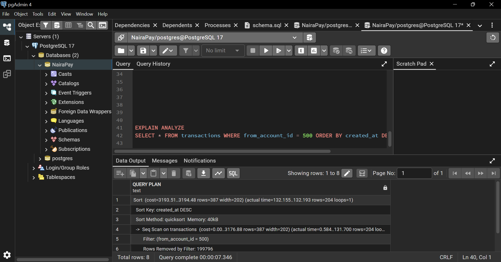
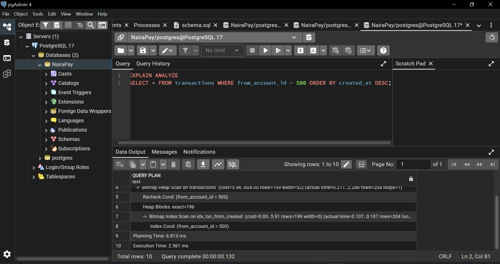

 ## Optimisation

I tested this query:

```sql
SELECT * FROM transactions WHERE from_account_id = 500 ORDER BY created_at DESC;
```

**Before the index:** PostgreSQL used a Seq Scan and took 132.261 ms.



I then created this index:

```sql
CREATE INDEX idx_txn_from_created ON transactions (from_account_id, created_at DESC);
```

**After the index:** PostgreSQL used an Index Scan and took 2.561 ms.



## Analysis

| | Before index | After index |
|---|---|---|
| Method used | Seq Scan | Index Scan |
| Execution time | 132.261 ms | 2.561 ms |

The index made this query about 52 times faster, a reduction of roughly 98%.

**Why it was slow:** without an index, PostgreSQL had to read all 200,000 rows to find the transactions for one account.

**Why it is fast now:** the index lets PostgreSQL jump straight to that account's rows instead of checking every row.

**Trade-off:** an index uses extra disk space and makes inserts slightly slower, because the index must be updated each time a row is added.
