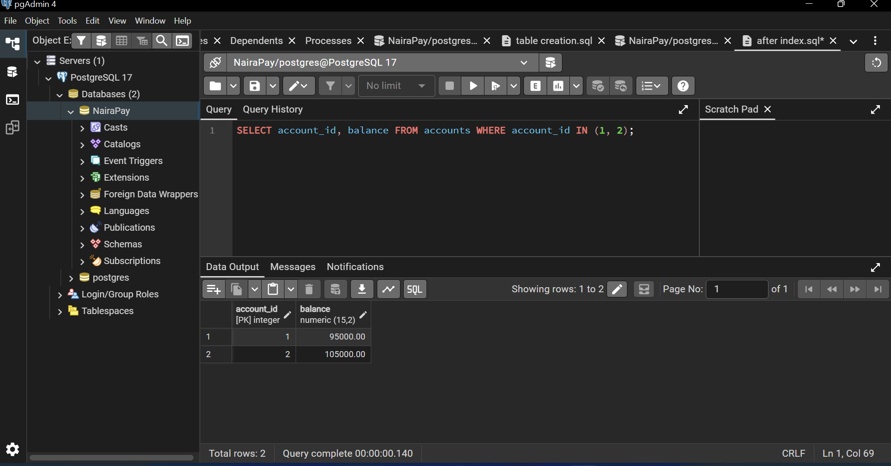
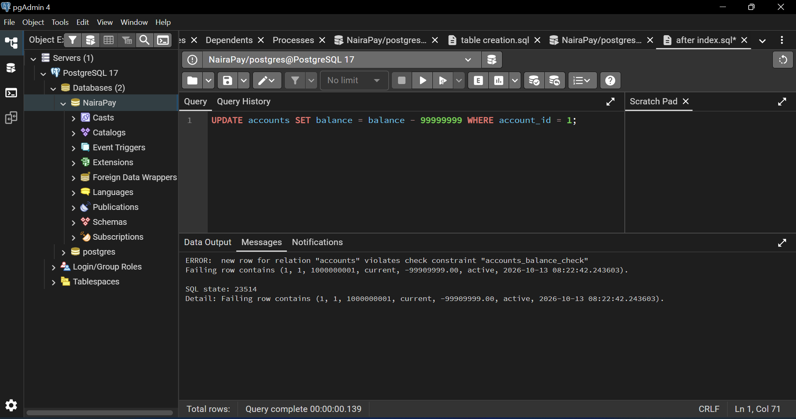
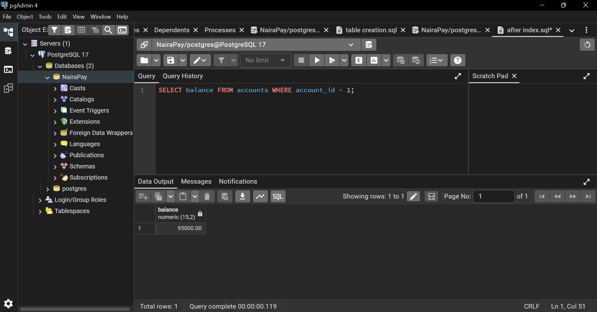
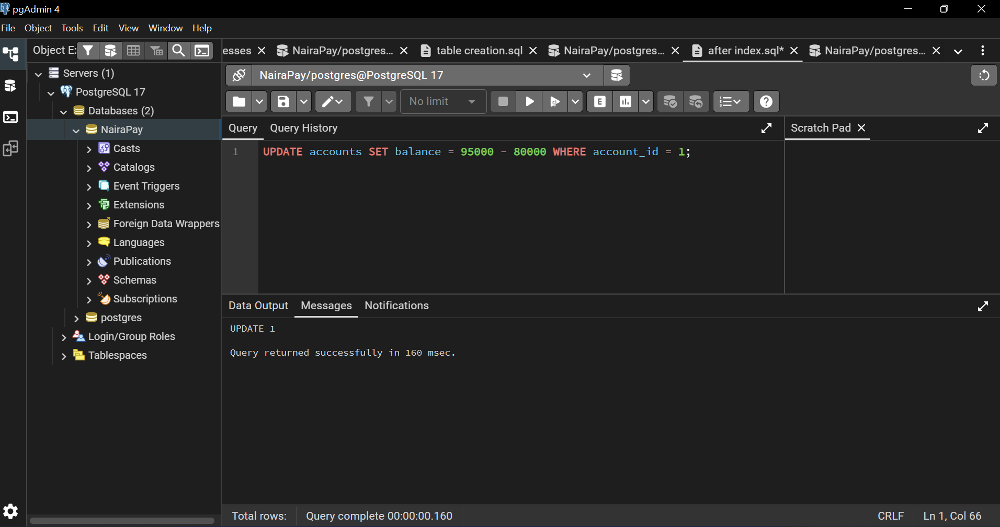
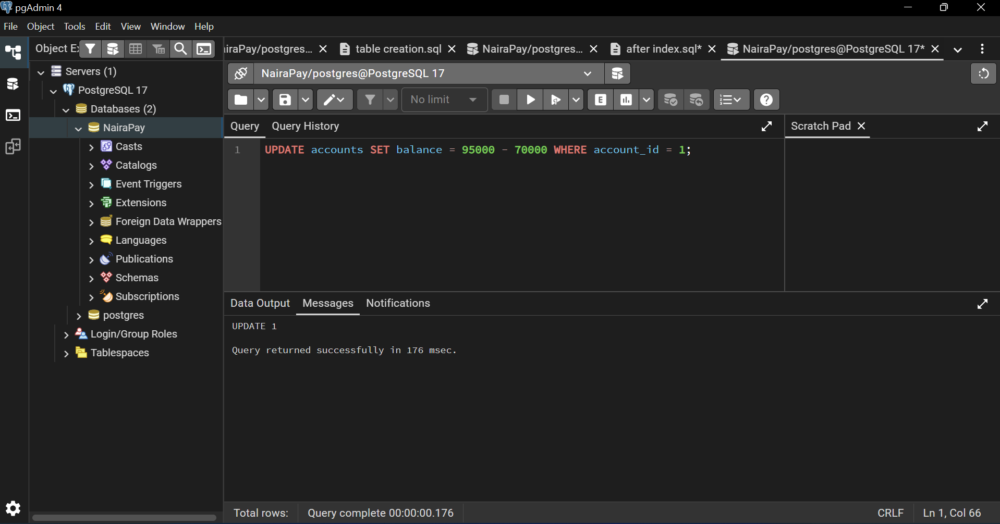
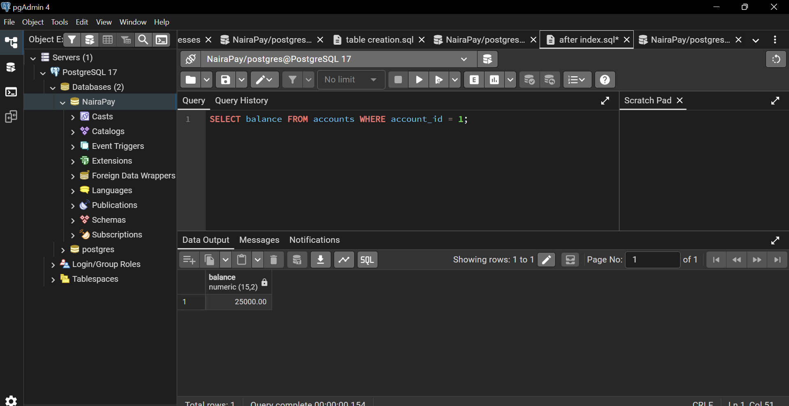
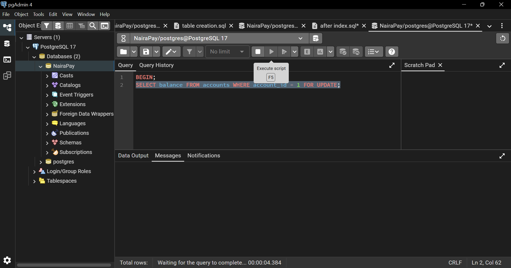
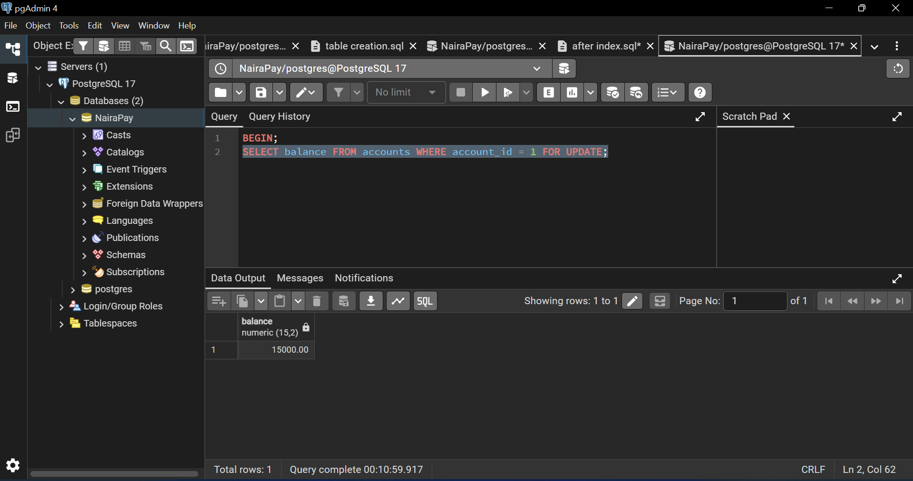

# Portfolio 3: Transactions and Concurrency (NairaPay)

This portfolio shows how a transaction keeps money movements safe in PostgreSQL, what goes wrong when two users change the same account at the same time, and how row locking fixes it.

I used PostgreSQL 17 and pgAdmin 4. To act as two different users, I opened two Query Tool windows (window A and window B). All the SQL I ran is in `transactions.sql`.

## Starting point

Accounts 1 and 2 both started with a balance of 100000.

## Demo 1: A successful transfer (COMMIT)

I moved 5,000 from account 1 to account 2 inside one transaction. The transaction started with BEGIN, deducted 5,000 from account 1, added 5,000 to account 2, recorded the transfer in the transactions table, and finished with COMMIT. Both changes were saved together.

The check query shows account 1 at 95000 and account 2 at 105000.

## Demo 2: A failed transfer (ROLLBACK)

I started a new transaction and deducted 5,000 from account 1. I then tried to deduct 99,999,999, which would have made the balance negative. This broke the CHECK rule on the accounts table (balance must be 0 or more), so PostgreSQL refused it with error 23514: new row for relation "accounts" violates check constraint "accounts_balance_check".

I then ran ROLLBACK to cancel the whole transaction. The balance of account 1 is back at 95000, so even the first 5,000 deduction was undone. This is atomicity: a transaction either happens completely or not at all.

## Demo 3: The lost update problem

I set account 1 to 95000 and opened a transaction in each window. Both windows read the balance as 95000 before either one had finished.

Window A withdrew 80,000, setting the balance to 95000 - 80000, and committed.

Window B was still using the old balance of 95000, so it withdrew 70,000 by setting the balance to 95000 - 70000, and committed.

The final balance is 25000.

This is wrong. A and B together withdrew 150,000 from an account that held 95,000, and A's withdrawal was overwritten. After A's withdrawal the real balance was 15000, so B's 70,000 request should have been refused. This is called a lost update.

## Demo 4: The fix (row locking with FOR UPDATE)

I reset account 1 to 95000 and repeated the test, but this time each window read the balance with SELECT ... FOR UPDATE inside its transaction.

Window A read the balance with FOR UPDATE, withdrew 80,000, and did not commit yet. When window B ran the same SELECT ... FOR UPDATE, it did not return. It stayed on "Waiting for the query to complete", because A had locked the row.

After window A ran COMMIT, window B continued and read the correct, up-to-date balance of 15000. B could now see that 70,000 was more than the money left, and it ran ROLLBACK instead of withdrawing.

## Summary

| Demo | What I did | Result |
|---|---|---|
| 1 | Transfer 5,000 with COMMIT | Both balances changed together (95000 and 105000) |
| 2 | Failed deduction, then ROLLBACK | Error 23514, balance back to 95000 |
| 3 | Two users withdraw at the same time, no locking | Final balance 25000 (wrong), lost update |
| 4 | Same test with FOR UPDATE | B waited, then saw 15000 (correct) |

## Isolation levels

Isolation levels control how much concurrent transactions can see of each other's work. PostgreSQL offers READ COMMITTED (the default), REPEATABLE READ and SERIALIZABLE. Stricter levels give more protection against problems like the lost update, but can be slower or make a transaction fail and need to be retried. A level can be chosen with BEGIN ISOLATION LEVEL SERIALIZABLE;

## Conclusion

Transactions keep money movements safe: COMMIT saves all the steps together and ROLLBACK cancels them all. When many users work at once, locking (FOR UPDATE) stops one user from overwriting another's changes, which is essential for a banking system.
