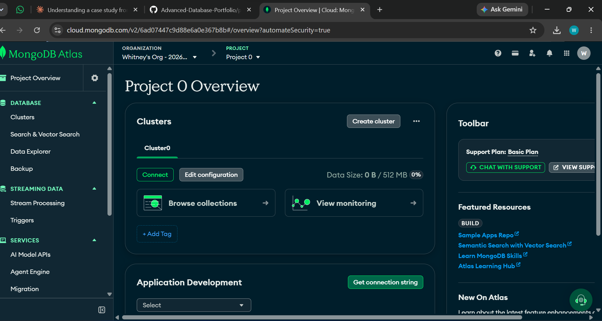
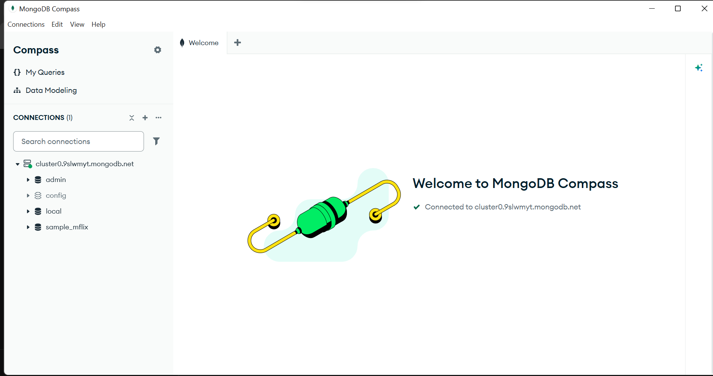
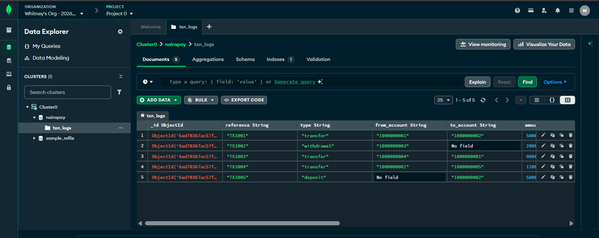
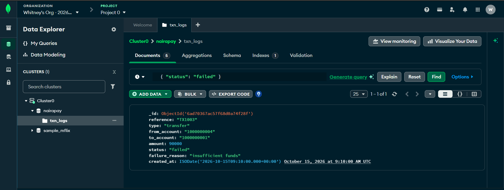
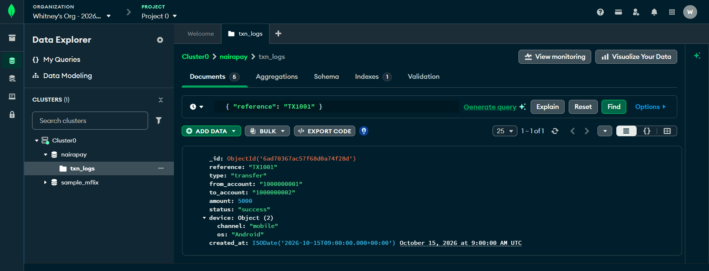
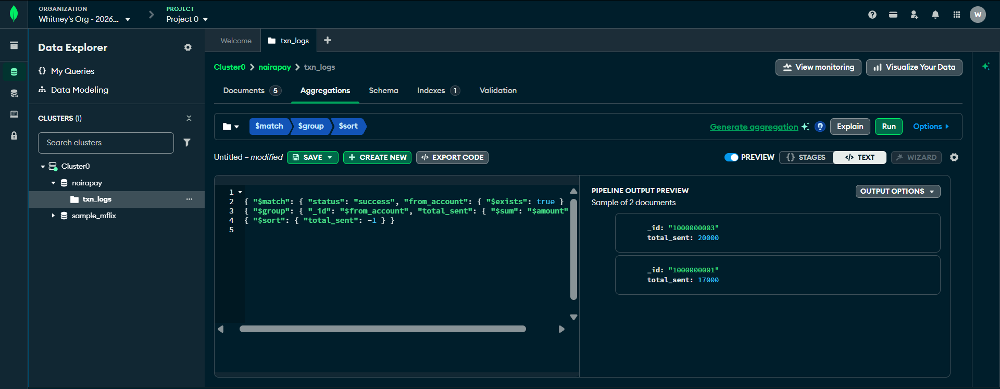
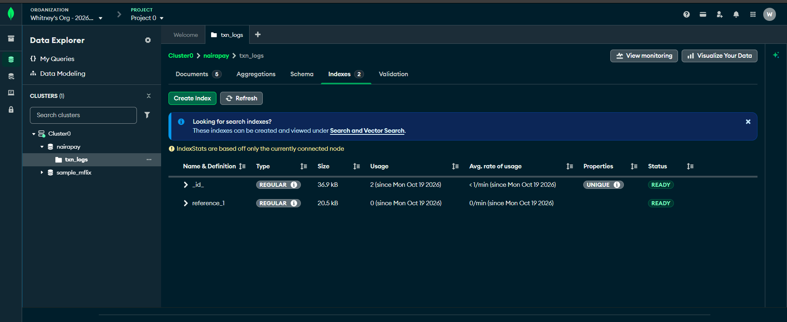

# Portfolio 4: NoSQL and Advanced Data Models (NairaPay)

This portfolio uses the same NairaPay case study as the other portfolios. I used MongoDB on a free MongoDB Atlas cluster. I connected to the cluster with MongoDB Compass and ran the operations in the Atlas Data Explorer in the browser. The same operations are written as mongosh commands in `nosql_commands.js`.

## Setup

I created a free cluster called Cluster0 on MongoDB Atlas (512 MB, free tier).



I then connected to it from MongoDB Compass.



## Data model

I chose the document model for the transaction log. Account balances and transfers stay in PostgreSQL, because they need strict rules and safe transactions (Portfolio 3). The log of what happened is written all the time, and different transaction types need different extra details, so each log entry is one document in a collection called `txn_logs`, inside a database called `nairapay`.

Example document:

```js
{
  reference: 'TX1001',
  type: 'transfer',
  from_account: '1000000001',
  to_account: '1000000002',
  amount: 5000,
  status: 'success',
  device: { channel: 'mobile', os: 'Android' },
  created_at: new Date()
}
```

## Implementation

I inserted 5 documents into `txn_logs`. They do not all have the same fields:

- TX1001 and TX1004 have a nested `device` object
- TX1002 has an `atm` object
- TX1003 has a `failure_reason`
- TX1005 has a `branch` object

In a SQL table, every one of these would need its own column, and most would be empty for most rows.



## Queries

**1. Find the failed transactions.** I used this filter:

```json
{ "status": "failed" }
```

It returned one document (TX1003, failed because of insufficient funds).



**2. Find one document and view its nested data.** I used this filter:

```json
{ "reference": "TX1001" }
```

The device information is stored inside the same document, so no join is needed to read it.



**3. Total sent per account.** I used an aggregation pipeline, which works like GROUP BY in SQL:

```json
[
  { "$match": { "status": "success", "from_account": { "$exists": true } } },
  { "$group": { "_id": "$from_account", "total_sent": { "$sum": "$amount" } } },
  { "$sort": { "total_sent": -1 } }
]
```

It keeps only successful transactions that have a sender, adds up the amounts for each sending account, and sorts the biggest total first. Account 1000000003 sent 20000 and account 1000000001 sent 17000.



**4. Index.** I created an index on `reference` so that searching for a transaction by its reference is fast, in the same way the index in Portfolio 2 sped up an SQL query.



## Why NoSQL suits this part of the system

- **Flexible structure:** each transaction type can carry its own extra fields without changing a table.
- **Nested data:** device, ATM or branch details sit inside the same document, so reading one log entry needs no joins.
- **Fast writes and easy growth:** logs are added constantly and are mostly read back, which MongoDB handles well.

## Where NoSQL does not suit

Balances and transfers need all-or-nothing transactions and strict rules, for example that a balance can never be negative. PostgreSQL enforces these with constraints, transactions and locking, as shown in Portfolio 3. A real bank would use both databases for different jobs, which is called polyglot persistence.

| | SQL (PostgreSQL) | NoSQL (MongoDB) |
|---|---|---|
| Structure | Fixed tables and columns | Flexible documents |
| Used here for | Customers, accounts, balances, transfers | Transaction logs |
| Strength | Strict rules and safe transactions | Flexibility and easy scaling |

## Files

- `nosql_commands.js`: the same operations written as mongosh commands

## Conclusion

MongoDB's document model is a good fit for the NairaPay transaction log because the entries vary in shape and are written constantly. SQL remains the right choice for balances and transfers, so each database is used for the work it does best.
