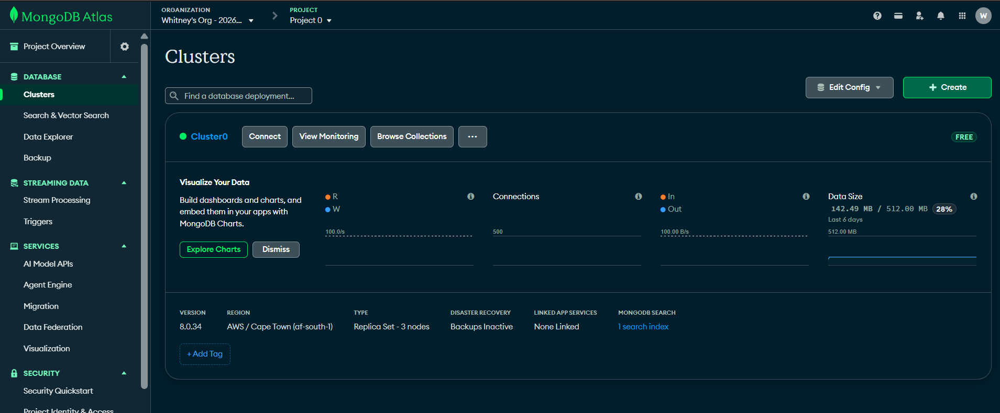
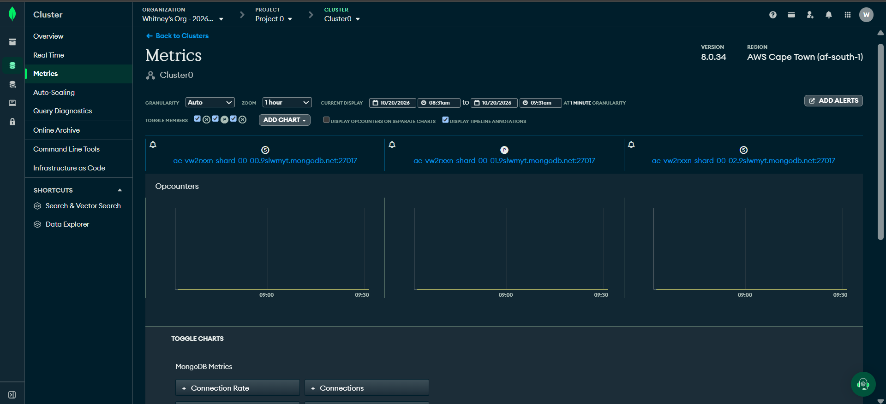

# Portfolio 5: Distributed and Cloud Database (NairaPay)

This portfolio explains how the NairaPay database can run as a distributed, cloud-based system. I use my MongoDB Atlas cluster as the real example for deployment and replication. Sharding is a design discussion only, because the free tier cannot be sharded.

## 1. Cloud deployment (evidence)

NairaPay's transaction log runs on MongoDB Atlas, a cloud database service. I deployed a free cluster called Cluster0. It runs on Amazon Web Services in the Cape Town region (af-south-1) and uses MongoDB version 8.0.34.



## 2. Replication (evidence)

An Atlas cluster is a replica set, which means the same data is copied onto several servers. The Metrics tab of my cluster shows three servers: shard-00-00, shard-00-01 and shard-00-02. The server marked P (shard-00-01) is the primary, which accepts writes. The two servers marked S are secondaries, and each holds a copy of the data.



| Server | Role | Job |
|---|---|---|
| shard-00-00 | Secondary (S) | Holds a copy of the data |
| shard-00-01 | Primary (P) | Accepts writes and sends changes to the secondaries |
| shard-00-02 | Secondary (S) | Holds a copy of the data |

How replication helps NairaPay:

- **High availability:** in a replica set, if the primary fails, the secondaries vote and one becomes the new primary. This is called failover, and customers can keep using the bank. I did not trigger a failure on my free cluster, so this is how the system is designed to work and not something I tested.
- **Data safety:** every transaction log exists on three servers, so losing one machine does not lose records.
- **Read scaling:** reports and audits can read from a secondary, which leaves the primary free for customer payments.

I can also ask MongoDB for stronger write safety. With a write concern of majority, a write is only confirmed after most servers have it. This is slightly slower but safer, which matters for financial records. The command is in `design_commands.js`.

The same idea exists in PostgreSQL, which holds the NairaPay balances: a primary server streams its changes to standby servers, which can take over if the primary fails.

## 3. Sharding (design only)

Sharding splits a very large collection across several servers, so each server holds only part of the data. Replication is for safety, and sharding is for size. NairaPay does not need sharding today. If it grew to millions of customers and billions of log entries, one replica set would run out of space and speed.

My design would shard the `txn_logs` collection on a hashed `from_account` field:

```js
sh.enableSharding('nairapay')
sh.shardCollection('nairapay.txn_logs', { from_account: 'hashed' })
```

| Choice | Reason |
|---|---|
| Shard key: `from_account`, hashed | A hashed key spreads documents evenly across the shards, so no single server gets all the work. |
| Not `created_at` as the key | New transactions always have the newest date, so they would all land on one shard (a hot spot). |
| Trade-off | A search that uses the shard key, such as one account's statement, goes to one shard. A search that does not use it must ask every shard, which is slower. |

Atlas Free clusters cannot be sharded, so I did not run these commands. They are written as design notes in `design_commands.js` and were not executed.

## 4. Consistency versus availability

When servers cannot reach each other (a network failure), a distributed database cannot guarantee that every answer is both up to date and always available. This trade-off is described by the CAP theorem.

For NairaPay's money, I would choose consistency. It is better for a customer to see a short error and retry than to see a wrong balance or have a transfer applied twice. This is why balances stay in PostgreSQL with strict transactions (Portfolio 3), and why I would use the majority write concern for the logs.

For less critical data, such as a dashboard counter, availability matters more, and slightly old data is acceptable.

## 5. Cloud benefits and risks

Benefits:

- No servers to buy or maintain
- Easy to scale up when the bank grows
- Replication is built in, and backups are available on paid tiers
- Pay for what you use

Risks:

- Ongoing cost as usage grows
- Depends on a good internet connection
- The provider controls the infrastructure
- Data location and privacy rules may limit where customer data can be stored. My own cluster is in Cape Town, South Africa, outside Nigeria, so a real Nigerian bank would have to check whether the rules allow this.
- The free tier has limits (small storage, limited speed and no sharding), so it is for learning and not for a real bank

## Files

- `design_commands.js`: design notes for the write concern and sharding commands (not executed)

## Conclusion

Replication gives NairaPay safety and availability, and my Atlas cluster shows it working with three servers. Sharding would give it room to grow, and I described how I would design it. For money, NairaPay should choose consistency over availability, so a real system would use PostgreSQL for balances and MongoDB for logs.
